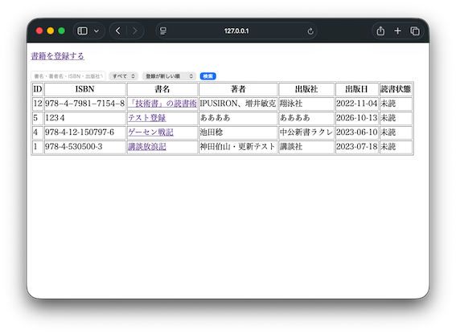
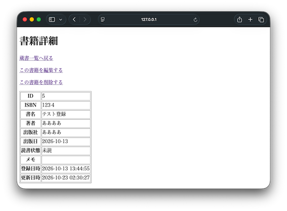
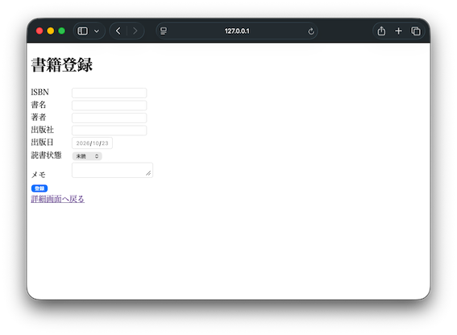
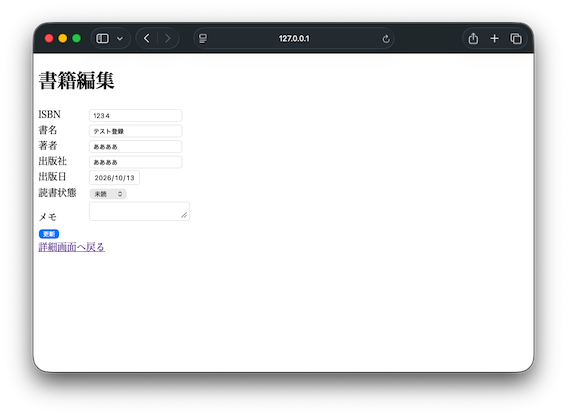
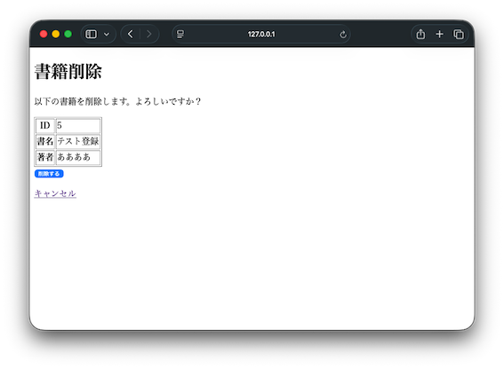

# BookShelf

このWebアプリケーションは、転職用のポートフォリオとして作成した、個人向けの書籍管理Webアプリケーションです。<br>
Webアプリケーションの設計・実装・テスト・GitHubを利用したソースコード管理までの、一連の開発工程を経験することを目的として作成しました。<br>
機能としては、所有している書籍の登録・編集・削除、キーワード検索、読書状態（未読・読書中・読了）の管理や並び替えができます。<br>

## 公開URL
https://htportfolio2026.pythonanywhere.com/books

## 主な機能

- 書籍一覧表示
  - 読書状態（未読/読書中/読了）による絞り込み
  - 並び替え（登録が新しい順/登録が古い順/書名順/出版日が新しい順）
  - 書名・著者・ISBN・出版社による検索



- 書籍の詳細表示



- 書籍の新規登録



- 書籍の編集



- 書籍の削除



## 使用技術

- Python
- Flask
- SQLite
- Jinja2
- HTML
- Git / GitHub

## データベース

SQLiteを使用しています。主な書籍情報として以下を管理します。

| 項目 | 内容 | 入力制限 |
| --- | --- | --- |
| ISBN | 書籍のISBN番号。任意 | 20文字以内 |
| 書名 | 書籍のタイトル。必須 | 200文字以内 |
| 著者 | 書籍の著者名。任意 | 200文字以内 |
| 出版社 | 出版社名。任意 | 200文字以内 |
| 出版日 | 書籍の出版日。任意 | 正しい日付形式 |
| 読書状態 | 読書状態（0：未読、1：読書中、2：読了）<br>初期値 0：未読 | 0 / 1 / 2 のみ |
| メモ | 書籍に関するメモ。任意 | 2000文字以内 |
| 登録日時 | 自動入力 | 入力不可 |
| 更新日時 | 自動入力 | 入力不可 |

## セットアップ手順
1. リポジトリを取得します。<br>
```bash
git clone https://github.com/ht-portfolio/bookshelf.git
cd bookshelf
```

2. 仮想環境を作成し、有効化します。<br>
```bash
python3 -m venv .venv
source .venv/bin/activate
```
3. 必要なパッケージをインストールします。
```bash
pip install -r requirements.txt
```

4. データベースを初期化します。<br>
```bash
python db.py
```

5. アプリケーションを起動します。<br>
```bash
python app.py
```

6. ブラウザでアクセスします。<br>
```text
http://127.0.0.1:5001/books
```

## 実装上のポイント

### 入力チェック

HTML側の required や maxlength にて必須入力と入力値の文字数制限を行い、Flask側でも同様に入力値を検証しています。<br>
ブラウザ側の入力制限だけに依存せず、不正な値がデータベースへ登録されないようにしています。<br>

### データベースの例外処理

ISBNには UNIQUE 制約を設定しています。<br>
重複したISBNを登録・更新しようとした場合は、SQLiteの例外をFlask側で処理し、ユーザーへエラーメッセージを表示します。<br>
また、例外発生時にはrollbackを行い、finallyでデータベース接続を必ずcloseすることで、接続が残ってデータベースがロックされることを防いでいます。<br>

### 検索・絞り込み・並び替え

キーワード検索、読書状態による絞り込み、並び替えを組み合わせて使用できます。<br>
SQLの並び替え条件については、外部から渡された値をそのままSQLへ組み込まず、許可した並び順のみを使用しています。

## 今後の拡張予定

追加を予定している機能は以下のとおりです。

- ISBNから書籍情報を自動取得
- ISBNバーコードのスキャン
- 書籍表紙画像の取得・表示
- ページング
- CSV入出力
- カテゴリ・本棚管理
- ユーザー管理

## 開発状況
基本的なCRUD、検索、読書状態管理、入力チェック、例外処理まで実装済みです。

